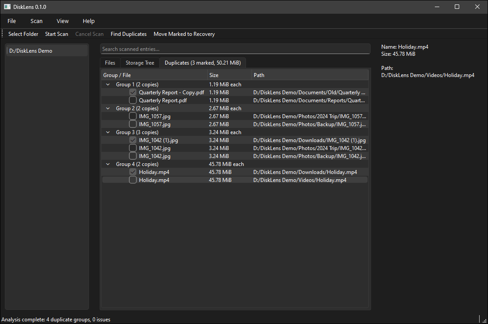

# DiskLens

DiskLens is a desktop app, written in C++17 and Qt 6, that shows where your disk space goes and helps you clean up exact duplicate files safely.



> **Status:** early development (v0.1.0). It is built and tested on Windows. The core code is written to stay cross-platform, but has not been tested on other systems yet.

## Features

- **Folder scanning.** Recursive scans run in the background, with progress and cancel.
- **Files view.** A searchable, sortable table of every scanned file.
- **Storage Tree.** A folder hierarchy with combined sizes, so the largest folders are easy to find.
- **Exact duplicate detection.** Files are grouped by size, then compared by sample hashes, a full SHA-256 hash, and finally byte by byte. Files that are missing, unreadable, or changed since the scan are reported, never guessed at. Hard links to the same file are not counted as duplicates.
- **Safe cleanup selection.** You mark which copies to remove. DiskLens always keeps at least one copy in every group.
- **Move to recovery.** Marked files are moved, never deleted, into a recovery folder on the same drive (`<drive>\.DiskLens Recovery\`). Each operation is listed in a preview, and you confirm it before anything happens.

## How cleanup stays safe

- **Nothing is deleted.** Files are moved by a same-drive rename, which either fully succeeds or doesn't happen. DiskLens never falls back to copying and never overwrites an existing file.
- **Files are re-checked before moving.** Just before a file is moved, its size and modified time are compared with the scan. The same check is made for at least one of the copies being kept. If either has changed, that file is skipped.
- **Every operation is recorded.** A JSON record is written to `%LOCALAPPDATA%\DiskLens\operations\` before any file moves, and updated with the result of each file afterwards.
- **Results are reported per file.** When a file is skipped or fails, you're told which one and why.

Restoring from inside the app is not built yet. Until it is, moved files can be put back by hand from the recovery folder, using the original paths saved in the operation record.

## Building

### Requirements

- Qt 6 (Core, Gui, Widgets, Test). Developed with Qt 6.11.1.
- CMake 3.25 or newer
- A C++17 compiler. Developed with the MinGW 13.1 toolchain that ships with Qt.

### Windows (MinGW)

The `windows-mingw-debug` preset in `CMakePresets.json` points to a Qt install at `D:/Qt`. If your Qt is installed there:

```powershell
cmake --preset windows-mingw-debug
cmake --build --preset windows-mingw-debug
.\build\windows-mingw-debug\DiskLens.exe
```

If Qt is somewhere else, configure manually instead. Change the paths to match your install:

```powershell
cmake -S . -B build -G "MinGW Makefiles" `
  -DCMAKE_PREFIX_PATH="C:/Qt/6.11.1/mingw_64" `
  -DDISKLENS_QT_DEPLOY_TOOL="C:/Qt/6.11.1/mingw_64/bin/windeployqt.exe"
cmake --build build
```

`DISKLENS_QT_DEPLOY_TOOL` is optional. When it's set, `windeployqt` copies the Qt DLLs next to the executable after each build.

### Tests

The tests use Qt Test and run through CTest:

```powershell
ctest --test-dir build/windows-mingw-debug --output-on-failure
```

| Test | Covers |
|---|---|
| `DuplicateFinderTests` | The duplicate detection pipeline, from size candidates to verified groups |
| `FileHasherTests` | Sample and full hashing, and detecting files that changed |
| `FileComparerTests` | Byte-by-byte comparison and its error cases |
| `FileIdentityTests` | Hard-link detection |
| `RecoveryServiceTests` | Moving to recovery, skip rules, never overwriting, and saving records |

The file tests use temporary folders only.

## Project layout

```
src/
  app/              Main window and app version
  core/filesystem/  Scanning, file metadata, file identity
  core/analysis/    Storage tree, hashing, comparison, duplicate detection
  core/jobs/        Background scan and duplicate jobs, cancellation
  core/operations/  Recovery moves and operation records
  ui/models/        Qt item models for the views
  ui/dialogs/       Cleanup preview dialog
tests/              Qt Test suites
docs/               Design notes and plans
```

The `core/` code depends only on Qt Core, so it can be tested without a GUI.

## Roadmap

- Restore and a recovery history view
- A treemap view of disk usage
- Cleanup suggestions for large, old, temporary and cached files
- Packaging for Windows, then support for other platforms

The full design is in [`docs/superpowers/specs/2026-09-10-disklens-design.md`](docs/superpowers/specs/2026-09-10-disklens-design.md).

## License

No license has been chosen yet, so all rights are reserved by the author. You're welcome to read the code, but please ask before reusing it.
